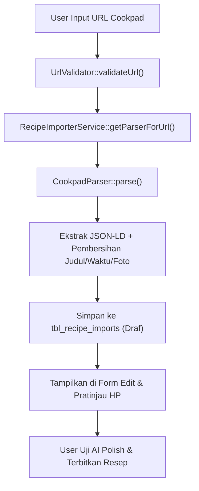

# Rencana Implementasi: Integrasi Cookpad Recipe Importer

Dokumen ini adalah rencana teknis penambahan dukungan impor resep dari portal **Cookpad** (`cookpad.com`), dengan prioritas pengujian pertama pada fitur **Impor Resep Tunggal (Single Recipe)** sebelum diintegrasikan secara penuh ke Batch Orchestrator.

---

## 1. Analisis Teknis & Kebutuhan Fitur

### 1.1 Target URL Spesifikasi
* **Contoh URL Pengujian:** `https://cookpad.com/id/resep/26787228` (Balado Terong, Teri Jengki Belah)
* **Pola URL Cookpad:** `https://cookpad.com/{lang}/resep/{id}` atau `https://cookpad.com/{lang}/recipes/{id}`
* **Format Data Sumber:** Standar Schema.org JSON-LD (`@type: Recipe`) dengan CDN gambar `img-global.cpcdn.com`.

### 1.2 Masalah yang Diselesaikan
1. **Pesan Validasi Terbatas:** `UrlValidator.php` sebelumnya menampilkan pesan bahwa hanya BBC Food yang didukung.
2. **Karakteristik Spesifik Cookpad:**
   - CDN gambar Cookpad memiliki variasi resolusi (`1200x630`, `600x852`, `300x426`, `.webp`). Parser perlu memastikan gambar master beresolusi tertinggi yang dipilih dan mengumpulkan foto per langkah jika ada.
   - Field `cookTime` sering tidak dicantumkan di JSON-LD Cookpad; parser perlu mengekstrak waktu dari deskripsi langkah atau memberikan estimasi default yang wajar (misal: 20-30 menit).
   - Pembersihan teks: judul resep Cookpad sering memuat nama penulis di akhir (misal: *"oleh LIA"*) atau hashtag/emoji yang perlu dibersihkan agar draf rapi.
3. **Penyelarasan UI:** Badge dan placeholder di tab Impor Manual (`importer.php`) perlu diselaraskan agar pengguna mengetahui Cookpad sudah didukung secara resmi.

---

## 2. Rincian Tahapan Implementasi



### Tahap 1: Pembuatan Dedicated Parser (`importer/parsers/CookpadParser.php`)
Membuat parser khusus untuk Cookpad yang mengimplementasikan `ParserInterface`:
- **`supports(string $url): bool`**: Mendeteksi apakah host adalah `cookpad.com` atau subdomainnya.
- **`parse(string $html, string $url): array`**:
  - Mengekstrak blok `<script type="application/ld+json">` yang memuat `@type: Recipe`.
  - Normalisasi data resep:
    - `recipe_title`: Judul resep dengan pembersihan suffix pembuat (misal menghapus *" oleh [Nama]"* jika terbawa di tag meta) dan pembersihan emoji.
    - `summary`: Deskripsi resep Cookpad.
    - `servings`: Nilai dari `recipeYield` (misal *"4-5 orang"* dinormalisasi menjadi *"4-5 Porsi"*).
    - `prep_time` & `cook_time`: Deteksi teks waktu memasak dari langkah instruksi (misal *"15 menit"*) atau fallback terstandar.
    - `ingredients`: Array bahan-bahan asli dari `recipeIngredient`.
    - `instructions`: Array langkah-langkah memasak dari `recipeInstructions` (`text`).
    - `image_candidates`: Array foto resolusi tinggi `1200x630` dari CDN Cookpad + foto langkah bila tersedia.

### Tahap 2: Registrasi Parser & Pembaruan Dependency
1. **`importer/RecipeImporterService.php`**:
   - Daftarkan `CookpadParser` di dalam array `$parsers`:
     ```php
     $this->parsers = [
         new CookpadParser(),
         new BbcFoodParser(),
         new JsonLdRecipeParser(),
     ];
     ```
2. **`importer.php`**:
   - Tambahkan `require_once('importer/parsers/CookpadParser.php');`.

### Tahap 3: Pembaruan Validasi Domain (`importer/UrlValidator.php`)
- Perbarui pesan error pada `validateUrl()` agar tidak hanya menyebut BBC Food, melainkan mencantumkan **Cookpad** dan portal resep berbasis Schema.org lainnya.
- Pastikan domain `cookpad.com` masuk dalam whitelist terverifikasi dan lolos filter SSRF.

### Tahap 4: Pembaruan Antarmuka Single Importer (`importer.php`)
- **Badge Status:** Perbarui badge Step 1 pada tab Impor Manual menjadi:
  `<span class="label label-primary">BBC FOOD &amp; COOKPAD SUPPORTED</span>`
- **Helper & Contoh Link:**
  - Tambahkan tombol quick-fill: **"Isi Contoh Cookpad"** (`https://cookpad.com/id/resep/26787228`) di samping tombol contoh BBC Food.
  - Perbarui placeholder input URL.

---

## 3. Rencana Pengujian oleh Pengguna (User Testing)

Setelah kode diterapkan, pengujian akan diserahkan kepada pengguna melalui Local Dev (`http://127.0.0.1:8090/importer.php`):
1. **Uji Pengambilan Resep:**
   - Masukkan URL: `https://cookpad.com/id/resep/26787228` pada tab *Impor Manual*.
   - Klik tombol **Ambil Data Resep**.
2. **Verifikasi Data yang Terekstrak:**
   - Judul: *"Balado terong, teri jengki belah"*
   - Porsi: *"4-5 Porsi"*
   - 10 Bahan lengkap (terong ungu, teri jengki, cabai, bawang, bumbu).
   - 3 Langkah memasak terurut.
   - Foto resolusi tinggi dari Cookpad tampil pada kandidat gambar dan pratinjau ponsel di kanan.
3. **Uji Lanjutan (AI Polish & Publish):**
   - Klik tombol **Polish Teks Resep dengan AI** untuk melihat hasil polesan.
   - Simpan draf atau terbitkan resep untuk memastikan tidak ada error pada database.

---

## 4. Status Persetujuan
- [x] Dokumen Rencana Implementasi Siap Ditinjau.
- [ ] Menunggu Konfirmasi User untuk Memulai Eksekusi Coding.
