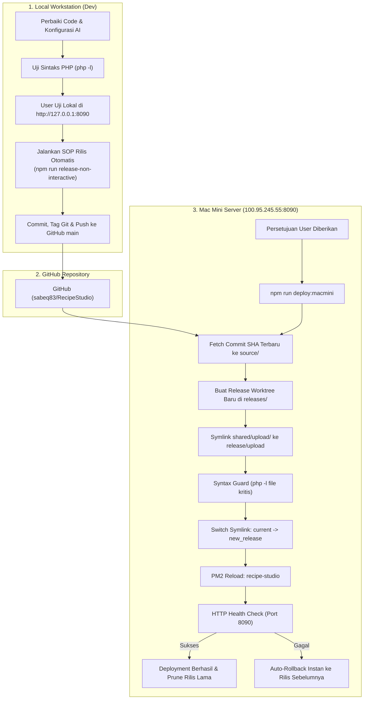

# Rencana Implementasi: Perbaikan AI Polish & Deployment Atomik ke Mac Mini

Dokumen ini adalah rencana teknis komprehensif untuk finalisasi perbaikan bug AI Polish (`Failed to fetch`), integrasi Cookpad Parser, dan prosedur rilis serta deployment ke server **Mac Mini Studio** (`masbenu@100.95.245.55`) mengacu pada SOP baku di `AGENTS.md` dan `sot/global/GIT_BASED_ATOMIC_DEPLOYMENT.md`.

---

## 1. Analisis & Sasaran Utama

### 1.1 Masalah yang Diselesaikan
1. **Bug `Failed to fetch` saat AI Polish**:
   - Koneksi HTTP terputus akibat model fallback non-aktif (`gemini-3.7-flash`, `gemini-3.8-flash`, `gemini-flash-latest`) yang menyebabkan timeout 45+ detik.
   - Ketiadaan `session_write_close()` menyebabkan session lock di PHP CLI built-in server saat eksekusi AI berlangsung lama.
2. **Dukungan Penuh Impor Resep Cookpad**:
   - Menerapkan parser dinamis `CookpadParser.php` untuk mengekstrak takaran bahan, instruksi memasak, porsi, dan foto kualitas tinggi dari Cookpad.
   - Memastikan `RecipeImporterService.php` memuat semua parser secara mandiri tanpa potensi fatal error `Class not found`.
3. **Deployment Zero-Downtime ke Server Mac Mini**:
   - Memastikan kode ter-commit, ter-tag, dan ter-push ke repository GitHub (`main`), kemudian dideploy ke server Mac Mini melalui mekanisme symlink atomik tanpa mengganggu data foto di `shared/upload/`.

---

## 2. Arsitektur Alur Rilis & Deployment



---

## 3. Rincian Tahapan Implementasi

### Fase 1: Finalisasi Perbaikan Lokal
1. **Optimasi Konfigurasi Database `tbl_ai_config`**:
   - Ubah `gemini_model` default menjadi `gemini-2.5-flash` (waktu respons 1.17s).
   - Bersihkan `gemini_fallback_models` menjadi `["gemini-3.6-flash"]` (menghapus model 3.7, 3.8, dan flash-latest yang hanging/timeout).
2. **Pelepasan Kunci Sesi (`session_write_close`)**:
   - Di `importer.php` pada action `ai_enhance_draft` (baris ~241) dan action batch AI lainnya, tambahkan `session_write_close()` sebelum memanggil `$aiService->enhanceRecipeData()`.
3. **Penyempurnaan Dependency Parser**:
   - Di `importer/RecipeImporterService.php`, tambahkan `require_once __DIR__ . '/parsers/CookpadParser.php'` dan parser lainnya secara eksplisit.
4. **Penyempurnaan Pesan Error Frontend**:
   - Di `importer.php` pada fungsi `safeFetchJson()` dan blok `.catch()` di `runAiPolish()`, tangani pesan jaringan secara jelas bila server lokal terputus.

---

### Fase 2: Pengujian & Validasi Lokal (Sebelum Rilis)
1. **Validasi Sintaks PHP**:
   ```bash
   php -l importer.php
   php -l importer/RecipeImporterService.php
   php -l importer/parsers/CookpadParser.php
   php -l ai/AiImageService.php
   ```
2. **Pengujian Fungsional di Browser Lokal (`http://127.0.0.1:8090/importer.php`)**:
   - Buka tab Impor Resep.
   - Masukkan link Cookpad (`https://cookpad.com/id/resep/26787228`) dan klik **Impor & Bedah Resep**.
   - Klik tombol **MULAI POLISH** pada Step 2 (AI Polish) dan pastikan:
     - Tidak ada alert `Failed to fetch`.
     - Proses selesai dalam < 3 detik.
     - Rekomendasi 3 judul, narasi summary, takaran bahan utuh, dan prompt foto muncul lengkap.

---

### Fase 3: Versioning & SOP Rilis Otomatis (Git & GitHub)
Sesuai aturan SOP di `AGENTS.md`, rilis dilakukan non-interaktif untuk menjaga konsistensi versi, changelog, dan Git tag:
```bash
npm run release-non-interactive -- \
  --type patch \
  --title "Fix AI Polish Timeout, Add Cookpad Support, and Authentic Cooking Method" \
  --points "Fix socket timeout & Failed to fetch with session_write_close and model pool optimization|Integrasi Cookpad recipe parser dinamis dengan pembersihan judul & foto resolusi tinggi|Dukungan pilihan bahasa fleksibel (Otomatis/Indonesia/Inggris) pada AI Polish & Batch Orchestrator|Penyempurnaan prompt AI Polish agar setia pada metode memasak asli resep tanpa pemaksaan alat|Penyempurnaan dependency loader di RecipeImporterService"
```
Perintah ini akan otomatis:
- Memperbarui versi di `package.json`.
- Mencatat riwayat di `sot/global/changelog.md`.
- Melakukan Git commit, tag Git (misal `v3.1.x`), dan push commit + tag ke branch `main` di GitHub.

---

### Fase 4: Pre-Flight Check Server Mac Mini
Sebelum mengeksekusi deployment ke server, lakukan verifikasi koneksi dan status service di Mac Mini:
1. **Periksa Status Rilis Aktif di Mac Mini**:
   ```bash
   npm run deploy:macmini:status
   ```
   *Memastikan host `macmini` (`100.95.245.55`) dapat dijangkau via SSH, PM2 `recipe-studio` aktif, dan symlink `current` mengarah ke rilis yang valid.*
2. **Jalankan Simulasi Deployment (Dry-Run)**:
   ```bash
   npm run deploy:macmini:dry-run
   ```
   *Memastikan Git commit SHA terbaru sudah terdeteksi dan alur script lolos tanpa error sebelum eksekusi riil.*
3. **Penyelarasan Konfigurasi AI di Database Mac Mini**:
   - Pastikan database MySQL di server Mac Mini juga menerapkan model `gemini-2.5-flash` dan fallback `gemini-3.6-flash`.

---

### Fase 5: Eksekusi Git-Based Atomic Deployment
> **CATATAN SESUAI ATURAN AGENTS.MD**: Eksekusi deployment ini **HANYA** dijalankan setelah User memberikan konfirmasi/instruksi persetujuan langsung.

Jalankan perintah deployment atomik:
```bash
npm run deploy:macmini
```
Mekanisme yang dijalankan oleh skrip:
1. Memasang lock file `.deploy-lock` di server Mac Mini.
2. Mem-fetch commit Git terbaru dari GitHub ke `/Users/masbenu/recipe_studio/source`.
3. Mengekstrak worktree ke rilis baru di `/Users/masbenu/recipe_studio/releases/<TIMESTAMP>-<SHA>/`.
4. Menyambungkan symlink storage permanen `shared/upload/` ke rilis baru.
5. Memvalidasi sintaks PHP seluruh file kritis dengan `php -l`.
6. Mengalihkan symlink atomik `/Users/masbenu/recipe_studio/current` ke direktori rilis baru (zero-downtime).
7. Me-reload proses PM2 `recipe-studio`.
8. Menjalankan HTTP health check pada port `8090`. Jika lolos, status rilis dicatat ke `deployment-manifest.json`.

---

### Fase 6: Verifikasi Pasca-Deployment (Post-Deploy Checklist)
Pengguna dapat menguji langsung di server Mac Mini Studio:
1. Buka URL Studio Mac Mini: `http://100.95.245.55:8090/importer.php`.
2. Uji Impor Resep Cookpad:
   - Tempel URL `https://cookpad.com/id/resep/26787228`.
   - Klik **Impor & Bedah Resep** $\rightarrow$ Periksa takaran 10 bahan & 3 instruksi.
   - Klik **MULAI POLISH** $\rightarrow$ Pastikan respons AI muncul cepat tanpa error.
   - Klik **Simpan Draf Resep** $\rightarrow$ Pastikan tersimpan di database Mac Mini.
3. Cek Status Rilis Akhir:
   ```bash
   npm run deploy:macmini:status
   ```

---

### Fase 7: Prosedur Kontinjensi & Rollback
Bila sewaktu-waktu ditemukan kendala tidak terduga pada server Mac Mini:
```bash
npm run deploy:macmini:rollback
```
Perintah ini akan mengembalikan symlink `current` ke rilis sebelumnya dalam 1 detik dan me-reload PM2 secara instan.
