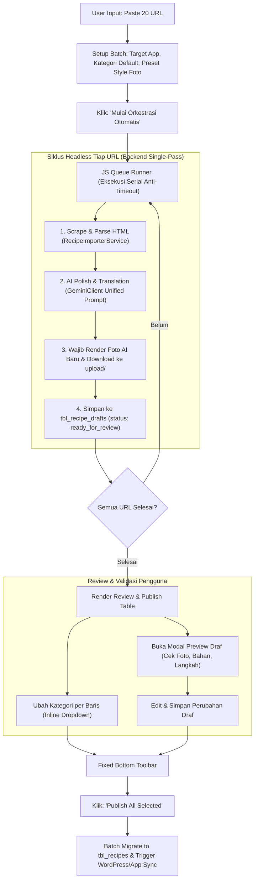

# Rencana Implementasi: Batch Recipe Orchestrator & Auto Workflow (Disempurnakan)
**Recipe Studio V3 — Automated Mass Ingestion Pipeline**

Dokumen ini adalah spesifikasi arsitektur baku dan panduan pengerjaan bertahap untuk modul **Batch Recipe Orchestrator** di Recipe Studio. Modul ini mengotomatiskan seluruh alur *scraping*, pemolesan teks dengan LLM (*strict ingredients preservation*), dan pembuatan foto AI makanan baru secara wajib (*mandatory fresh AI image*), dilengkapi dengan editor kategori instan, modal preview resep lengkap, dan publikasi massal 1-klik.

---

## 1. Prinsip Utama & Fitur yang Disepakati

1. **Otomatisasi Tanpa Pop-up (Headless Pipeline):**
   Pengguna cukup memasukkan 1–50 URL resep sekaligus. Sistem mengeksekusi antrian secara serial tanpa ada dialog pop-up konfirmasi yang mengganggu.
2. **Reuse Prompt Sempurna (100% Konsistensi):**
   Proses pemolesan teks menggunakan fungsi dan prompt terpusat yang sudah terbukti di `ai/GeminiClient.php` (menjaga 100% takaran bahan, judul menggugah selera, instruksi air fryer dengan suhu & tips kerenyahan, serta preservasi nutrisi).
3. **Mandatory Fresh AI Image (Wajib Unik):**
   Sistem **selalu** men-generate foto makanan AI baru dari prompt fotografi resolusi tinggi hasil analisis LLM dan men-download-nya ke storage lokal `upload/`. Foto dari web sumber luar **tidak digunakan** demi orisinalitas dan keamanan hak cipta.
4. **Input & Edit Kategori Resep Fleksibel:**
   - **Tingkat Batch:** Menentukan kategori default untuk seluruh URL dalam antrian + opsi cepat menambah kategori baru (`+ Tambah Kategori Baru`).
   - **Tingkat Baris (Inline di Tabel Review):** Dropdown kategori langsung pada setiap baris resep di tabel review sebelum dipublikasikan.
   - **Tingkat Modal:** Sinkronisasi kategori di dalam modal preview.
5. **Modal Preview & Inspector Draf Siap Publish:**
   Modal interaktif untuk meninjau secara mendalam: foto AI resolusi tinggi, judul, deskripsi aroma (*summary*), daftar takaran bahan lengkap, dan instruksi langkah memasak. Pengguna dapat langsung mengedit dan menyimpan perubahan sebelum publish.
6. **1-Click Publish All & Auto-Push:**
   Satu tombol untuk mempublikasikan seluruh draf yang dicentang ke tabel utama `tbl_recipes` dan otomatis memicu sinkronisasi (*push*) ke WordPress / target mobile app.

---

## 2. Alur Kerja Sistem (End-to-End Workflow)

---

## 3. Rincian Teknis Modul & Endpoint Baru

### A. Endpoint Backend Baru pada `importer.php`

| Action (`ajax_action`) | Metode | Parameter Input | Deskripsi & Hasil |
| :--- | :---: | :--- | :--- |
| `orchestrate_single_url` | POST | `url`, `product_code`, `default_cat_id`, `style_preset`, `aspect_ratio` | Menjalankan pipeline lengkap per URL (Scrape $\rightarrow$ Polish $\rightarrow$ Generate Foto AI $\rightarrow$ Download ke `upload/` $\rightarrow$ Simpan draf). Mengembalikan data draf lengkap untuk tabel review. |
| `quick_add_category` | POST | `category_name`, `product_code` | Menambahkan kategori baru ke `tbl_category` secara instan dan mengembalikan `cat_id`. |
| `update_draft_detail` | POST | `draft_id`, `recipe_title`, `summary`, `cat_id`, `ingredients`, `instructions` | Menyimpan revisi judul, kategori, atau teks dari Modal Preview ke `tbl_recipe_drafts`. |
| `bulk_publish_drafts` | POST | `draft_ids[]`, `auto_push` (boolean) | Memindahkan array draf ke `tbl_recipes`, menghubungkan file foto permanen, dan mentrigger `SyncClient` jika auto-push aktif. |

---

### B. Struktur Data Draf (`tbl_recipe_drafts`)
Memastikan kolom-kolom berikut terisi secara konsisten:
* `recipe_title`: Judul hasil pemolesan LLM.
* `summary`: Deskripsi hook rasa & nutrisi.
* `ingredients_json`: Array takaran bahan yang 100% terjaga.
* `instructions_json`: Langkah memasak air fryer bernomor.
* `selected_image_url`: Path lokal file foto yang di-download (misal: `upload/recipe_ai_142_1730182900.webp`).
* `cat_id`: ID kategori (dari default batch atau pilihan inline).
* `product_code`: `airfry`, `nusasaji`, atau `proteinprep`.
* `status`: `ready_for_review` $\rightarrow$ berubah ke `published` saat user menekan *Publish All*.

---

### C. Komponen Antarmuka di Frontend

1. **Tab Baru "Batch Orchestrator" pada `importer.php`:**
   - Tampilan bersih dengan palet **Nordic Warm** (Terracotta `#C2410C`, Oat `#FAF8F5`, Sand `#F5F1EB`).
   - Kotak textarea URL dengan penghitung URL otomatis (`Terdeteksi: 15 URL valid`).
   - Selektor preset: Target App, Kategori Default (+ link popup tambah kategori), dan Style Foto AI.
2. **Monitor Antrian Real-Time:**
   - Progress bar dinamis (0% s/d 100%).
   - Kartu progres URL dengan 4 badge indikator:
     `[#1] 1. Scrape ✓ -> 2. AI Polish ✓ -> 3. AI Photo Gen ✓ -> 4. Ready ✓`
3. **Tabel Peninjauan (Review Table):**
   - Checkbox *Select All* / individu.
   - Thumbnail foto AI baru (bisa diklik untuk membuka modal preview).
   - Judul resep dengan link preview.
   - **Dropdown pemilih kategori inline** di setiap baris.
   - Rincian jumlah bahan, estimasi waktu, dan kalori.
   - Tombol `[👁️ Preview Draf]`.
4. **Modal Preview Draf (Ready-to-Publish Inspector):**
   - Foto AI resolusi penuh dengan label verifikasi.
   - Quick metrics: waktu persiapan, waktu memasak, dan kalori.
   - Form input judul & textarea summary.
   - Daftar bahan terstruktur & langkah memasak bernomor.
   - Selektor kategori terintegrasi.
   - Tombol `[Simpan Perubahan Draf]`.
5. **Fixed Floating Action Bar:**
   - Ringkasan: `X resep terpilih`.
   - Checkbox switch: `Otomatis Push Sync ke WordPress / App Target`.
   - Tombol utama: **`[ ✨ Publish All Selected (X Resep) ]`**.

---

## 4. Rencana Tahapan Eksekusi (Implementation Phases)

### Fase 1 — Backend Pipeline & Image Generation
* Implementasi method `orchestrateSingleUrl()` pada `importer.php` & `importer/RecipeImporterService.php`.
* Integrasikan pemanggilan `AiImageService->enhanceRecipeData()` (prompt terpusat) dan eksekusi generate foto AI baru (`submitImageTask` + auto-download ke `upload/`).
* Buat endpoint `quick_add_category` dan `bulk_publish_drafts`.

### Fase 2 — UI Batch Orchestrator & Inline Category Selector
* Integrasikan tampilan tab *Batch Orchestrator* di `importer.php` dengan palet Nordic Warm.
* Tambahkan form input multi-URL, kontrol batch settings, dan tombol tambah kategori.
* Siapkan kerangka tabel review lengkap dengan dropdown kategori per baris.

### Fase 3 — Modal Preview & Inspector Resep
* Bangun markup dan JavaScript untuk `#recipePreviewModal` (foto, takaran bahan, langkah air fryer, dan tombol simpan perubahan).
* Hubungkan event simpan modal ke endpoint `update_draft_detail` untuk memperbarui data baris tabel secara instan.

### Fase 4 — Queue Runner Asinkron & Bulk Publish
* Implementasi worker JavaScript berbasis `async/await` yang memproses antrian URL secara serial (mencegah timeout server dan rate limit).
* Implementasi tombol *Publish All* dengan indikator loading dan konfirmasi sukses pemindahan ke `tbl_recipes`.

### Fase 5 — Validasi Sintaks & Pengujian Mandiri oleh User
* Validasi sintaks PHP (`php -l`).
* Penyerahan URL pengujian lokal kepada User pada:
  👉 `http://127.0.0.1:8090/importer.php`
* Menguji dengan 3–5 URL nyata untuk memvalidasi alur tanpa pop-up, foto AI baru, dan tombol publish massal.

---

> [!NOTE]
> Sesuai SOP `AGENTS.md`, agen tidak akan melakukan testing browser otomatis dan tidak akan melakukan deployment ke Mac Mini sebelum pengujian lokal disetujui oleh User.
